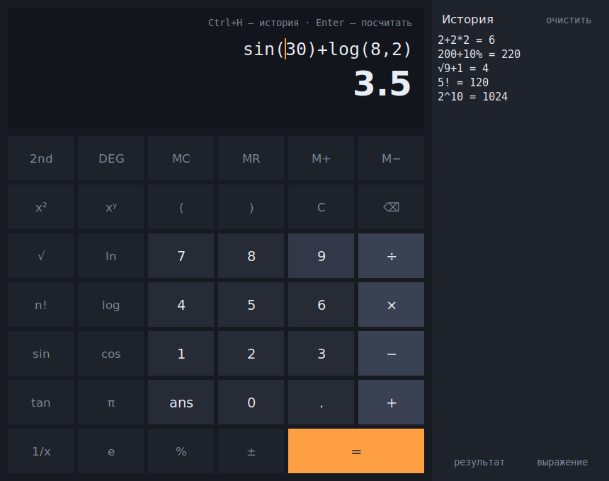

# Калькулятор

Инженерный калькулятор на чистом Python: оконный режим на Tkinter, консольный
REPL и разбор выражений без `eval()`. Внешних зависимостей нет — проект
открывается в PyCharm и запускается сразу.



## Быстрый старт

1. `File → Open` в PyCharm, выбрать папку проекта.
2. Выбрать интерпретатор Python 3.10+ (`Settings → Project → Python Interpreter`).
3. В списке конфигураций уже лежат готовые (папка `.run`):
   * **Калькулятор** — окно;
   * **Калькулятор в консоли** — REPL в терминале;
   * **Тесты** — pytest.

Или из терминала:

```bash
python main.py             # окно (если Tkinter нет — консоль)
python main.py --cli       # REPL
python main.py "2+2*2"     # посчитать и выйти
```

Tkinter входит в стандартный Python на Windows и macOS. На Linux иногда нужен
отдельный пакет: `sudo apt install python3-tk`.

## Что умеет

**Ввод как на бумаге.** `2pi`, `3(4+5)`, `2x` — неявное умножение; `√9`, `sin 30`
— функции без скобок; `×`, `÷`, `−`, `π`, `√`, `²`, `³` понимаются наравне с
обычными символами.

**Проценты как в жизни.** `200+10%` → `220`, `200-10%` → `180`, `100*10%` → `10`,
а `10%3` — это остаток от деления, `1`. Калькулятор различает случаи по контексту.

**Живой ответ.** Результат считается прямо во время набора, ещё до `=`. Для целых
чисел под ответом показываются HEX/OCT/BIN.

**Переменные и `ans`.** `x = 5`, дальше `2x^2` → `50`. `ans` всегда хранит
прошлый результат.

**Точность.** Целые не теряют разрядов (`2^100` считается полностью), а
`sin(180)` в градусах даёт ровный `0`, а не `1.2e-16`.

**Память** — `MC`, `MR`, `M+`, `M−`. **История** — справа, двойной клик по строке
подставляет результат, кнопка «выражение» — исходную запись.

### Горячие клавиши

| Клавиша | Действие |
|---|---|
| `Enter` | посчитать |
| `Esc` | очистить |
| `↑` / `↓` | листать историю |
| `Ctrl+H` | показать/спрятать историю |
| `Ctrl+Shift+C` | скопировать результат |
| `F9` | сменить знак |

### Синтаксис

| Запись | Значение |
|---|---|
| `+ - * / // %` | арифметика, целочисленное деление, остаток |
| `^` или `**` | степень, правоассоциативная: `2^3^2` = 512 |
| `!` | факториал: `5!` = 120 (для дробных — гамма-функция) |
| `%` после числа | процент: `10%` = 0.1 |
| `& \| << >>` | побитовые операции над целыми |
| `0xff`, `0b1010`, `0o17`, `1_000`, `1e-3` | форматы чисел |

**Функции:** `sin cos tan asin acos atan atan2 sinh cosh tanh asinh acosh atanh
sqrt cbrt root exp ln log log2 log10 log1p abs sign round floor ceil trunc frac
fact gcd lcm comb perm hypot deg rad mod pow min max sum avg median rand randint`

**Константы:** `pi`, `e`, `tau`, `phi`, `inf`, `nan`.

Тригонометрия считает в градусах или радианах — переключатель `DEG`/`RAD` в окне,
команды `deg` / `rad` в консоли.

## Как устроено

```
calculator/engine.py   токенайзер, парсер рекурсивным спуском, вычислитель
calculator/gui.py      окно на Tkinter
calculator/cli.py      REPL и разовый подсчёт
main.py                точка входа
tests/test_engine.py   95 тестов на ядро
```

Выражение не передаётся в `eval()`: строка разбирается вручную, поэтому
выполнить через поле ввода посторонний код невозможно. Ошибки (`деление на
ноль`, `неизвестное имя: foo`, `ожидалось ')'`) описаны по-русски.

## Тесты

```bash
pip install -r requirements-dev.txt
pytest
```
